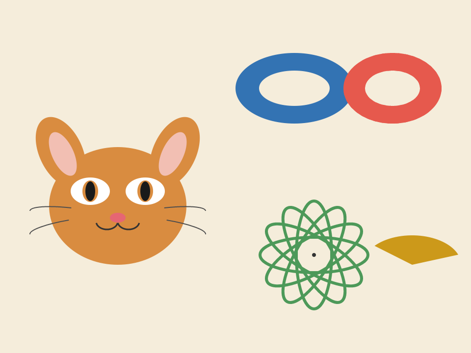

## artkit: ellipse path builders (issue #1053, 2026-11-07)

Every program that drew a cat, a cup or a face redefined
`/ellp { matrix currentmatrix 5 1 roll 4 2 roll translate scale 0 0 1 0 360 arc setmatrix } def`
and tripped on its two traps: wrapping the `scale` in `gsave`/`grestore`
loses the path (`grestore` restores the path too), and a cutout needs the
opposite winding.

- `ellipse` / `ellipsen` (closed, counterclockwise / clockwise),
  `ellipsearc` / `ellipsearcn` (open, as `arc` / `arcn`), each also with a
  `...rot` form taking `rot` degrees (counterclockwise about the centre) as
  the last operand. Separate names because a stack cannot tell an optional
  operand from the next call's (the `ctext` / `ctextctr` precedent). Eight
  public names plus the internal `elrun`.
- One `[a b c d tx ty] concat` per call (translate, rotate, scale in one
  matrix) and `setmatrix` after, not `gsave`. The matrix is built from the
  operands before the CTM is touched, so a bad operand (`typecheck`) leaves
  the caller's CTM alone, and a zero radius raises
  `ellipse-radii-must-be-nonzero` (pscat accepts a singular `concat`, and the
  path would be garbage). Negative radii are taken as magnitudes, since a
  negative `scale` would silently reverse the winding the pair relies on.
- The closed forms `moveto` the start point first, so a path already under
  way gets no stray connector (a bare `arc` draws one); the arc forms keep
  `arc`'s behaviour. Angles are parametric (the circle that is stretched),
  so 90 is always `cx cy+ry`.
- Tests: two `%%SelfTest` blocks (CTM restored on success and after a
  refused operand; bounding boxes, rotation, guards, current point) and
  three in `tests/artkit.rs` (ring hole by pixel under nonzero, even-odd and
  clip, with a same-winding negative control; parametric arc end points; new
  subpath and CTM). `src/capabilities.rs` has the eight entries and
  `elrun` in `ARTKIT_INTERNAL`: `artkit.ps` is still on the hand-written
  catalog, and `artkit_names_match_the_catalog_exactly` fails otherwise.

