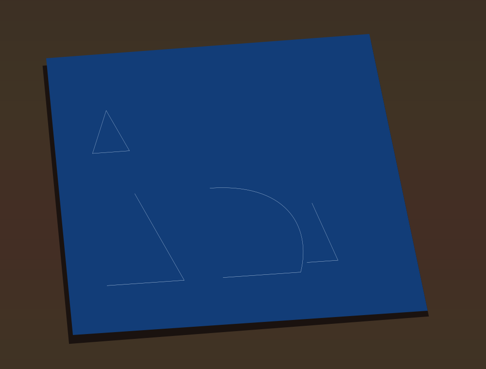
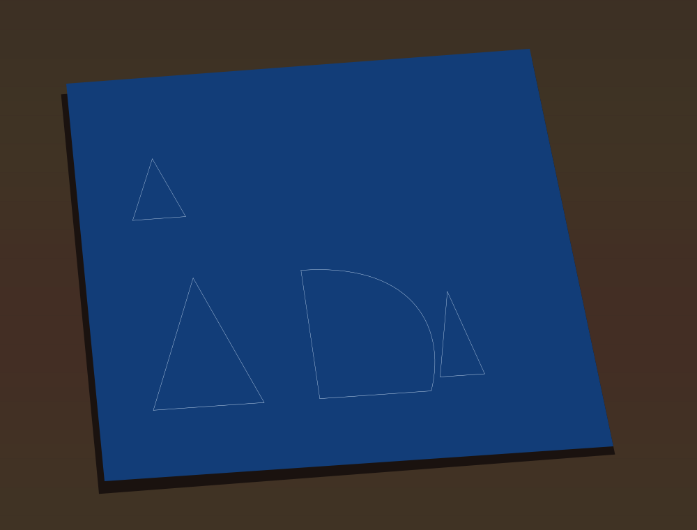

## blueprint_rose: outline-fill closes open subpaths (issue #1173, 2026-11-12)

`gallery/blueprint_rose.ps` traces every `fill` and `eofill` as a hairline
stroke. A real fill closes each open subpath implicitly; a stroke does not,
so an open subpath lost its closing edge. A new `/close-subpaths` helper runs
first inside `/outline-fill`'s `gsave`: it reads the path with `pathforall`,
puts a `closepath` before each later `moveto` and at the end wherever a
subpath is open, and rebuilds the path.

- It rebuilds only when a subpath was actually open. Otherwise the path is
  left as it was, so a program with only closed shapes draws exactly as before.
- It keeps curves (no `flattenpath`) and tracks an "open" flag rather than the
  previous record, which also handles a `lineto` that follows a `closepath`
  without a `moveto`.
- It works in its own small dictionary, so it never writes into the drawing
  program's dictionary, and like `/hairline` it is bound before the warp scope
  exists.

The piece itself does not change: `cathedral_rose.ps` fills only one closed
box, so `/close-subpaths` never rebuilds anything and
`gallery/renders/blueprint_rose.png` is byte-identical (checked with the
documented 2x render). The fix is shown on a scratch program that runs the same
decorator setup and then fills open shapes (an open triangle, an open curve,
two open subpaths in one `eofill` next to a closed one):

Not done: `decs /rectfill` is still the warp's solid fill, not an outline.
`cathedral_rose.ps` never calls it.
