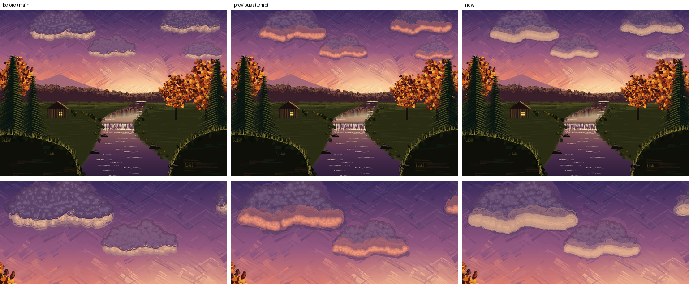

## Evening Stream: the clouds' light from `pkscumblein /Light` (issue #384, 2026-10-14)

`gallery/evening_stream.ps` lit its clouds from below with a trick (#187): the
whole cloud scrubbed in the light colour, then the body over it shifted up 0.3 of
its height, leaving a crescent. `pkscumblein /Light /Reach /Feather` (#345) does
that natively, and the landscape cookbook's recipe 2 already used the native
form, so the source piece no longer matched its recipe. Only the `.ps`, the
2x still and docs change; no `lib/` change.

Left to right: the still on main, the first rework (a saturated orange-pink band
across the cloud's middle, with a grey-violet rim left below it), and the final
one. Below, the two left clouds close up.

- **New `evcloud`.** The body is scrubbed over the whole outline (no shift) and
  worked wet into the sky (`/Soft 0.6 /Under` the sky behind it), as before. Then
  three `pkscumblein /Light 270` passes lay the old cream-peach underside
  (`evRIM` toned 0.28 toward the sky behind the cloud) on it, each reaching
  nearer the edge and brighter than the last: a half-light (`/Reach 0.28
  /Feather 1`, counts x3), a core (`/Reach 0.1`, circles 0.85x) and a rim right on
  the edge (`/Reach 0.03`, full-size circles, `/Squash 0.9`). All three are worked
  wet into the sky (`/Soft 0.3 /Under` the sky), so the underside fades into the
  sky instead of leaving a grey-violet ring.
- **Why the first rework failed.** `/Light` keeps circles whose *centres* are
  within `/Reach` of the lit edge, and the light circles were smaller than the
  body's (0.6x) with the light's `pkwet` mixing toward the body colour, so the
  body's own dark outline and the body-coloured fringe stayed visible below the
  glow, and the saturated rose (`evROSE`) made it a stripe. The fix is circles
  as big as the body's in the last pass, a lower `/Edge` (which darkens a brush's
  rim) on the light passes, `/Under` the sky, and the cream of the old crescent.
- **Taller clouds.** The shifted copy had made every cloud about 0.3 taller than
  its outline. With no shift the clouds came out squat, so `evch` went from 0.28
  to 0.36 of the width (0.32 was tried: no better, and the changed counts moved
  the circles).
- **Random state.** Every `evcloud` starts from its own `srand`, and `evridge`
  reseeds next, so nothing downstream moves. Checked: against the still on main
  (rendered after merging main), one pixel differs outside the four cloud boxes,
  in the wet halo just under the left cloud.
- **Review.** Maintainer review of the first rework (a saturated stripe) led to a
  second one: five more renders (a flat tube, ringed circles with `/Squash 1`, then
  the final).
- **Reproducibility.** Two 2x renders are byte-identical; `--lint` is clean;
  Ghostscript renders the scene without errors (correctness only; its rand
  stream differs).
- **Left alone** (separate tickets): the waterfall `/Scatter`, and #433, the lit
  band's rings and even tone along each cloud's length (the light now grades up
  smoothly from the body, but circles still show in the core at 2x).
- **Halo.** A 2.5x crop of the right-hand cloud's underside: a thin dark outline
  (the cloud's drawn contour, as on the top) is left below the cream and nothing
  spills on the sky.
