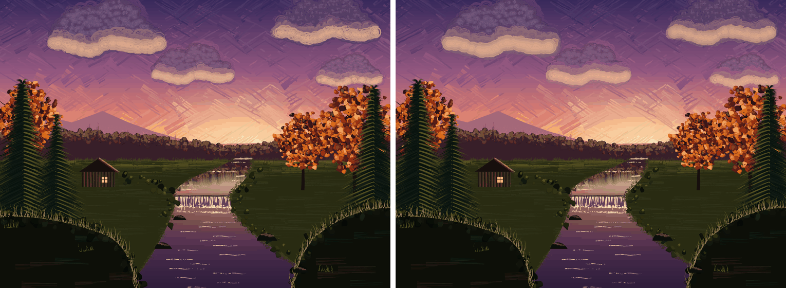
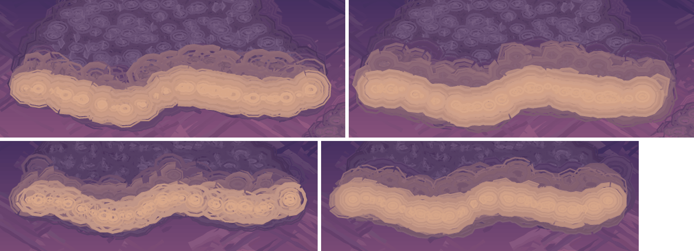

## Evening Stream: softening the clouds' light (issue #433, 2026-10-14)

#384 moved the clouds' lit underside to three `pkscumblein /Light 270` passes
worked wet into the sky. Two things were left: concentric rings in the bright
core at 2x, and a thin dark contour under the cream. Only `evcloud` in
`gallery/evening_stream.ps`, the 2x still and one sentence of the cookbook change;
no `lib/` change.

- **Where the rings come from** (a one-change-at-a-time round on a cloud-only
  render): with no `pkwet` round the light passes, the bullseyes stayed (they are
  the brush's own: a 1.9-2.2x-radius `pkbroad` stroke along a small circle, with
  `/Depletion` stepping the load round it) but the stepped, polygonal contours
  between tones went (those are `pkwet`'s displaced, graded layers). So both had
  to move: the brush toward one flat patch per circle, the wet layers toward a
  gentler grade.
- **The change.** Brush widths 2.2/1.9/2.2 -> 2.2/2.3/2.4 x the circle radius and
  `/Depletion` 0.5/0.4/0.4 -> 0.2/0.1/0.1 (half-light, core, rim); the wet pass
  over the three light passes `/Soft 0.3` -> `0.6`. Counts, radii, `/Reach`,
  `/Feather`, `/Edge` and the colours are as in #384, so the look (cream-peach
  underside fading up into the body) is the same.
- **The dark contour** was not the body's `/Edge` (the body with `/Edge 0` left it
  as it was) but the body's own wet halo (`/Soft 0.6`) showing past the light's
  narrower one (`/Soft 0.3`): a violet sliver below the cream. A light wet as soft
  as the body's covers it, and what is left under the cream is a soft mauve
  halo into the sky.
- **Tried and not kept.** Soft 0.6 with 2.6/2.8x brushes: rings gone, but the band
  grew a third wider and swallowed the body. Soft 0.45: no contour sliver
  hidden, a dark line came back. A narrower `/Reach` (0.22, 0.08): thinner band, and
  the half-light thinned out into stripes. Not tried: per-pass `pkwet` with `/Under`
  the layer beneath (half of each halo falls on sky, so it brings back the grey-violet
  rim #384 removed), and a load that varies along the cloud's length (see the
  follow-up).
- **Pixels.** The render differs from the still on main only inside the four cloud
  boxes (each cloud's outline box plus 20 pt: 0 differing pixels outside them).
  Two 2x renders are byte-identical; `--lint` is clean; Ghostscript renders the
  scene without errors (correctness only).
