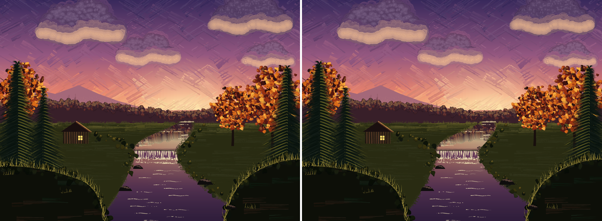
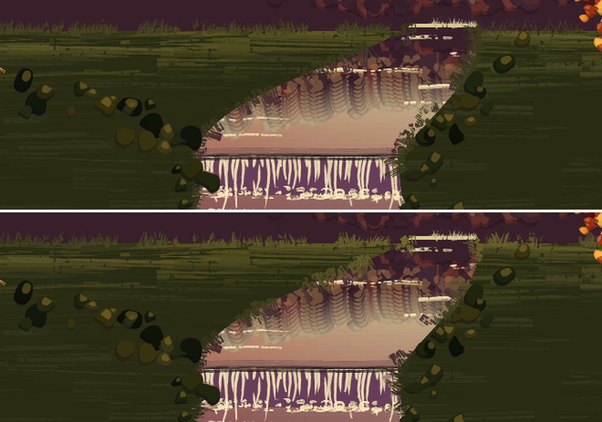

## Evening Stream: the meadow's light on its edges, and the stream behind the banks (issue #455, 2026-10-14)

#382 brushed Evening Stream's edges with one pull-out colour each: a compromise
lit-meadow mix along the far shore, nearly plain meadow beside the stream. With
`pkbrushedge /Mass` (#426) and region-list `/Under` (#456) the edges can carry
the meadow's light, and the near banks can follow the stream exactly. Only
`gallery/evening_stream.ps`, the 2x still, the gallery technique text and one
sentence of `docs/guides/painting.md` change; no `lib/` change. `evcloud` is
untouched.

- **`evmeadowat`** (x y -> r g b), the new `/Mass` procedure: plain meadow lit
  with the yellow of its light by a share that is largest right on the far
  shore, fades to nothing 60 pt toward the viewer, and is scaled by the glow
  (strongest at the sun's x, about a ninth of that at the far corners). It draws
  nothing random. Used by the far shore (`evfaredges`) and both stream banks
  (`evbankedges`), so the shore catches the light under the glow and the banks
  pick it up only at their far ends, then match plain meadow (no yellow
  spikes, which is why #382 had settled for a dull single colour).
- **`evunderbank` is gone.** The near banks' rim is `/Under [ [ /evstreampath
  load /evwaterat load ] evMEADOW ]`: the stream's own fill picks water, the
  meadow is the default, so the cuts follow the stream's outline exactly (the
  straight-line guess was a crude pair of lines). The rim corners differ by
  about 600 px each; the bush, tuft and grass marks of the banks did not move.
- **Why the glow factor.** The meadow's own strokes are graded in y only, so a
  y-only `/Mass` would be one colour along the (horizontal) far shore, which is
  no better than before. The x term is what the issue's "lit toward the glow"
  needs. It lives in the edge colour only, not in the meadow fill, which keeps
  the diff to the edges: the edge's light is a touch of grass catching the glow.
- **Calibration.** Round 1 took the meadow's own tone as painted (about 20% lit
  at the shore, from sampling the old still): a bare change. Round 2 pushed it a
  little. Round 3 (kept): about 30% lit, times the glow factor 0.25 to 2.15, which
  at the stream's mouth is about 65% (the strokes are thin, charge 0.8 and
  depleting, so they read far less lit than their colour).
- **Random state.** One procedural `/Mass` stroke is one `/Brush` call, so
  `evfaredges` now draws differently. The stream and the fall are painted next
  and start from whatever state that leaves, so `evfaredges` ends by resetting
  to the state the old one left (`2133854749 srand`, read off the old file with
  `rrand`): the water, the reflection and the fall are byte-identical.
  `evbankedges` is followed by `evstreamhead`, which reseeds.
- **Pixels** (2x, against the committed still): 24 004 pixels differ, in the
  far-shore band (y 244 to 256 pt, the whole width), along the two stream banks'
  edges, and at the near banks' lower rim corners. Counted in boxes clear of
  those: 0 differ in the four cloud boxes (each cloud's extent plus 10 pt), in
  the whole picture at y >= 258 pt, in the fall (x 352-436, y 150-180), the
  stream's upper reach (x 395-440, y 185-205) and lower water (x 360-440,
  y 20-140), the cabin's body (x 160-230, y 196-241), the left meadow
  (x 40-250, y 60-230), the right tree (x 590-700, y 262-420) and everything
  below y = 150 outside the stream's banks.
- **Edge lit beyond the fill.** The meadow's own strokes carry no x term, so
  near the stream's mouth the edge is deliberately lit more than the fill
  behind it (about 60% against 20 to 25%): grass tips catching the glow. Putting
  the glow into `evmeadow` itself would let the edge match the fill; that is a
  wider change than the edges, filed as #471.
- **Reproducibility.** Two 2x renders are byte-identical; `--lint` is clean;
  Ghostscript renders the scene without errors (correctness only).
