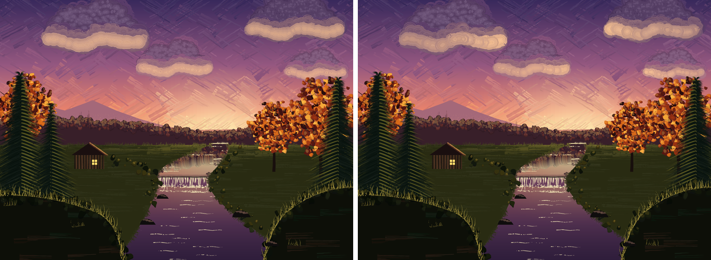
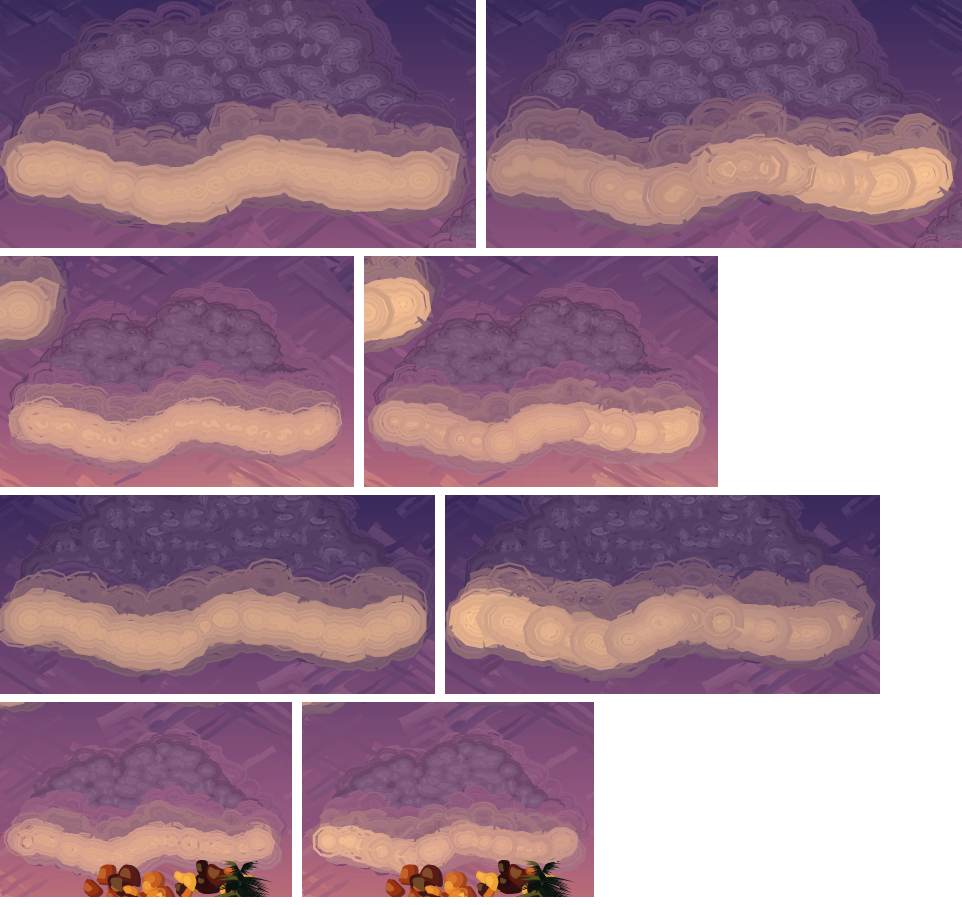

## Evening Stream: the clouds' light load follows the glow along each cloud (issue #462, 2026-10-14)

After #384 and #433 the lit underside of each cloud was smooth but one load along
its whole length. A painter loads it fullest under the lump nearest the sun and
lets it cool toward the far end. Now it does. Only `evcloud` and new helpers in
`gallery/evening_stream.ps`, the 2x still, one sentence of
`docs/guides/landscape-cookbook.md`; no `lib/` change (the issue guessed a
paintkit feature might be needed; it was not).

Close-up, before left and after right, top to bottom: the left cloud, the middle
one, the right-hand big one and the small one.

- **The approach.** `pkscumblein /Light` builds each light pass's circles as a
  path and `pkbroad` strokes it. `evcflat` reads that path back with `pathforall`
  (curves replayed as they are, no flattening); `evcgrouped` gives every circle a
  load `a` from the x of its centre and strokes the circles level by level (12
  levels, `a` from 0.7 to 1.25), each level in its own `evclit`: the cream-peach
  dimmed toward the cloud's body below 1, warmed toward the raw peach (`evRIM`,
  untoned by the sky) above 1. `a = 1 + 0.4 (evglowat(x + jitter) / mean - 1)`,
  `evglowat` being the meadow and edge glow factor of #455 and #471, `mean` its
  average over this cloud's length, so a cloud's overall load stays what it was
  and only its slope along the length is new. `jitter` is a hash of the circle's
  place (up to 6% of the cloud's length either way), so the levels interleave
  instead of meeting on a line.
- **Why not clipping or a `lib/` change.** Clip strips would leave hard colour
  seams, and `pkwet /PerFill` asks for the backdrop, not the load. Splitting the
  circle path per level needs neither, and it spends no random draw (the grouping
  is a hash, not `rand`). Splitting one `pkbroad` call into several does change
  which circle gets which per-subpath draw, but every `evcloud` starts from its
  own `srand` and `evridge` reseeds next, so nothing outside the cloud boxes moves.
- **Calibration.** Mean of the brightest 15% of pixels (a luma, 0 to 255) in the
  sun-side and far thirds of each cloud's box, 2x, against main:

  | cloud | before (far / mid / sun side) | after | mean before / after |
  |---|---|---|---|
  | left (x 100-310) | 172 / 173 / 173 | 157 / 164 / 187 | 172 / 169 |
  | right big (x 540-730) | 171 / 170 / 171 | 159 / 168 / 183 | 171 / 170 |
  | small right (x 620-740) | 177 / 177 / 176 | 169 / 176 / 185 | 177 / 177 |
  | middle (x 320-450, below y 445 pt) | 180 / 180 / 180 | 176 / 181 / 188 | 180 / 182 |

  Every row reads far end first, sun side last. The middle cloud is measured on
  x 320 to 450 pt and below y 445 pt, because the left cloud's bright end overlaps
  the rest of its box.
- **Tried.** Slope 0.5, range 0.6 to 1.4, 7 levels: the far end dropped nearly to
  the body and the sun end went yellow, and the level steps showed as separate
  discs. Slope 0.45 with 0.6 to 1.3 and 12 levels: a clear grade but still discs on
  the far end and octagonal ring edges at the bright end. Kept 0.4 with 0.7 to 1.25,
  12 levels, and a small jitter. The levels are painted outside in, the one nearest
  the plain load last, so the extremes do not sit on top.
- **K = 1 identity.** With the slope set to 0 every circle falls in one level and
  the render matches main in all but 22 pixels (largest channel difference 4 of 255),
  all in the cloud boxes: most likely the path rebuilt from `pathforall`'s user-space
  numbers, which round-trip through the 2x scale.
- **Pixels.** 142 223 pixels differ against the still on main (2x), all inside the
  four cloud boxes (each cloud's outline extent plus 15 pt, the #433 boxes); 0
  outside. Two 2x renders are byte-identical; `--lint` is clean; Ghostscript
  renders the scene without errors (correctness only). The 2x still is the site's
  landing hero, so that changes too.
- **Left alone.** The bullseye rings the brush stamps and the wet layers' polygonal
  edges (seen in #384 and #433) are still faintly there, and read a little more at the
  bright end, where the tones differ more: filed as #519 (p3).
- **State.** The piece's new `def`s (`evclit`, `evcops`, ...) go where every other
  `ev` scratch name does: pkwet opens no dictionary, so they land in `userdict`, and
  each cloud redefines them before reading them.
