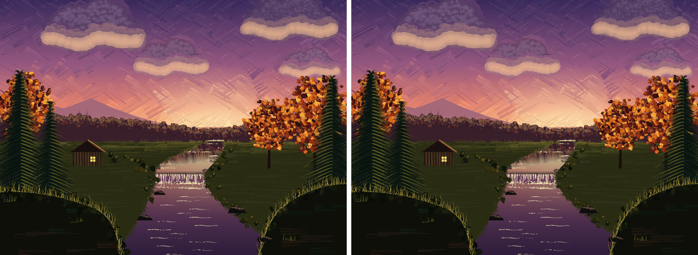
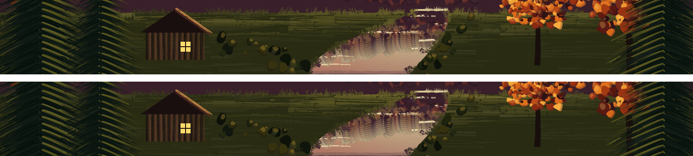
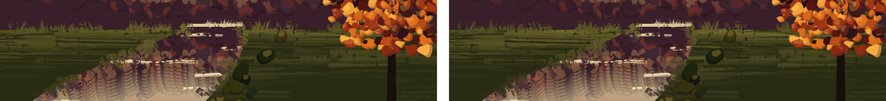

## Evening Stream: the meadow fill lit by the same glow as its edges (issue #471, 2026-10-14)

#455's `evmeadowat` lit the far shore and the stream banks by a glow factor in x
(strongest at the sun's x), but the meadow fill (`evmeadow`) graded its strokes in
y only, so near the stream's mouth the brushed edges were lit well beyond the
fill behind them (about 40 to 45% against 28 to 32% as rendered). Now the fill's
strokes carry the same glow. Only `gallery/evening_stream.ps`, the 2x still and
one sentence of `docs/guides/painting.md` change; no `lib/` change, and `evcloud`
is untouched.

- **Two shared helpers.** `evglowat` (x -> factor, 0.25 at the far corners to
  2.15 under the sun; the old inline expression of `evmeadowat`) and `evlity`
  (y -> lit share, 0.5 on the far shore fading to 0 at 45 pt toward the viewer;
  the old fill's own y fade). `evmeadow` lights each stroke by
  `evlity x evglowat x 0.8` (clamped to 1) at the stroke's middle (`evx + 40`);
  `evmeadowat` uses the same two factors with a gain of 0.55 (it was 0.3 on its own
  60 pt fade; `evlity`'s peak is 0.5, so the nominal share on the shore goes from
  `0.3 x glow` to `0.275 x glow`). Both fade out at 45 pt now, so a bank's edge no
  longer keeps its light 45 to 60 pt below the shore where the fill has gone plain.
- **Same random draws.** `evmeadow` still makes the same `chance`/`frnd`/`evj`
  calls in the same order, so every mark stays where it was; only colours change.
  `evfaredges` reseeds next, so nothing downstream moves.
- **Why the gains differ.** Same nominal share, different pixels: the fill is
  double-loaded (`/Colors`, `/ColorMix 0.6`, charge 0.7) and the edge is a thin
  single-colour stroke, so an edge stroke reads about twice as lit. Gains were
  settled on sampled pixels, not on the formula.
- **Calibration** (2x, the share of the way from meadow to lit-meadow colour,
  over strokes near the meadow-to-light line; edge band = the 4 pt above the far
  shore, fill band = the 9 pt below it):

  | x window (pt) | before edge / fill | after edge / fill |
  |---|---|---|
  | 0-60 (left corner) | -0.04 / 0.01 | -0.04 / 0.01 |
  | 120-180 | 0.11 / 0.16 | 0.11 / 0.08 |
  | 270-330 | 0.24 / 0.14 | 0.22 / 0.12 |
  | 400-450 (mouth, left) | 0.42 / 0.32 | 0.39 / 0.39 |
  | 496-550 (mouth, right) | 0.45 / 0.28 | 0.40 / 0.34 |
  | 620-680 | n/a / 0.31 | n/a / 0.22 |
  | 710-760 (right corner) | 0.06 / 0.02 | 0.06 / 0.01 |

  Tried first: fill 1.0, edge 0.5 (fill overshot the edge at the mouth, 0.46 / 0.35),
  then fill 0.8 with edges 0.6, 0.8 and fill 1.0 with 0.75: the edge ran 0.07 to 0.2
  above the fill at the mouth. Kept fill 0.8, edge 0.55.
- **A visible change to review.** The meadow is no longer one lit tone along the
  shore: it brightens toward the mouth and the glow, and the left and right fill
  go a little darker toward the corners (about 0.16 -> 0.08 at x 120-180).
  Under the sun the fill's share was 0.5 flat and is now up to 0.8 x 0.5 x 2.15
  clamped to 0.86; across the whole width the glow averages near 0.9, so the
  overall tone is close to before.
- **Pixels** (2x, against the committed still): 43 804 pixels differ, all in the
  meadows' strokes: x 0 to 760, y 187 to 255 pt. 0 differ at y >= 256 pt, in the
  four cloud boxes (each cloud's extent plus 15 pt, the #433 boxes), the fall
  (x 352-436, y 150-180), the lower water (x 360-440, y 20-140), the right tree
  (x 590-700, y 262-420) or anywhere below y = 150 outside x 340-450. The cabin's box (x 160-230, y 196-241) has
  1 658 differing pixels, meadow strokes around its base.
- **Reproducibility.** Two 2x renders are byte-identical; `--lint` is clean;
  Ghostscript renders the scene without errors (correctness only; its rand stream
  differs, so its marks fall elsewhere).
