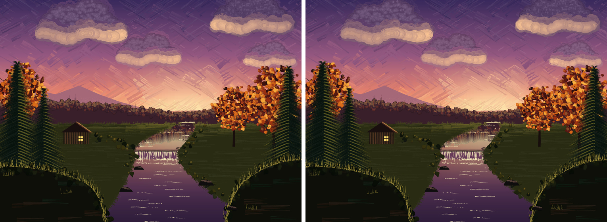
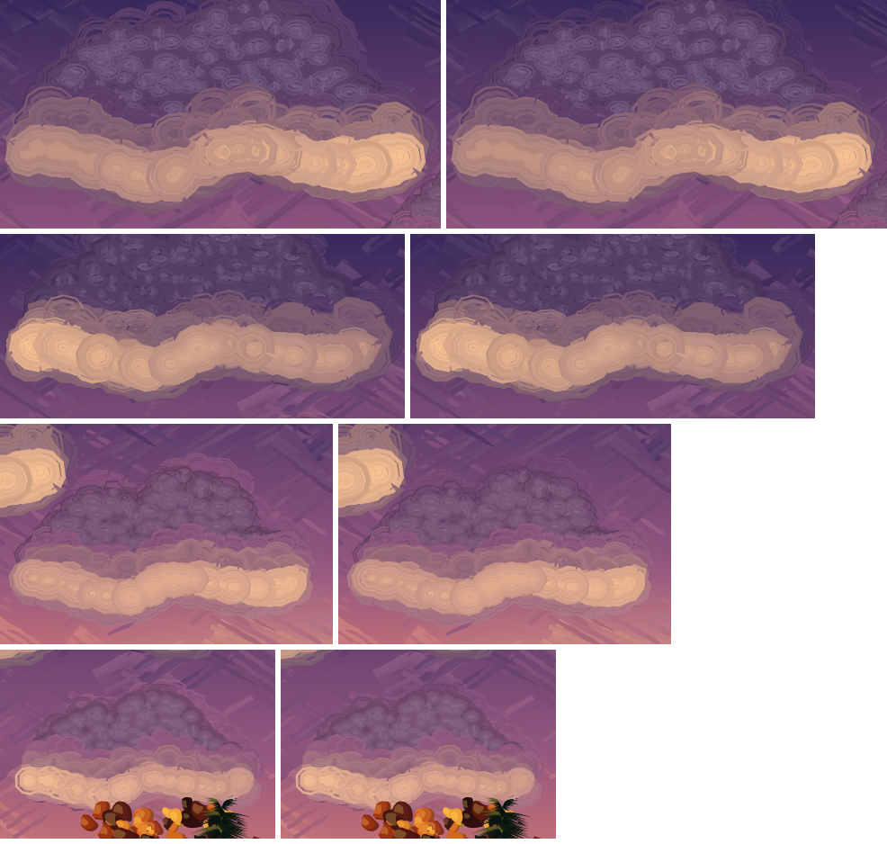
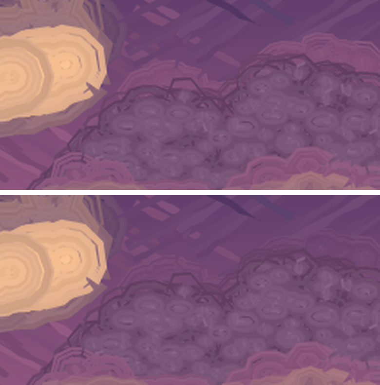

## Evening Stream: the cloud bodies' wet edge asks the sky at each stroke (issue #491, 2026-10-14)

#403's `pkwet /PerFill` asks the backdrop at each loaded-colour fill instead of once
per pass. Of the gallery's paintkit pieces only Evening Stream's clouds qualify
(`pkbroad` with `/Colors` under a `pkwet`; Alpine Lake's wet marks are sprays, which
`/PerFill` cannot reach). Until now their `/Under` was `evcunder`, the sky at the
cloud's centre: one colour per cloud, so a cloud's top halo was mixed toward a
lighter sky than the one behind it. The body's `pkwet` is now
`/Under { evskyat } /PerFill true`, so each stroke is mixed toward the sky at its own
place. Only `evcwet` (the body's options) and the body's `pkwet` call in `evcloud`
changed, in `gallery/evening_stream.ps`; no `lib/` change. It is a **modest**
gain, at the top edge of each cloud; it is easy to miss at the full picture's size.

Close-ups, before left and after right, top to bottom: the left cloud, the middle
one, the right-hand big one and the small one. The third image is the right-hand big
cloud's top edge at 3x: before, a pinkish-mauve band (the centre sky's colour) sat
on the darker violet sky above the body; after, it settles into it.

- **Body only.** The first try gave the lit underside's three passes the per-fill
  sky too. That moved the top rim the same way but made the foot worse: the fringe
  under the cream came out lighter than the sky (bottom rim distance 15.3 to 19.4,
  signed luma +10 to +16), because what is left there is the cream's own
  contribution, not the backdrop's, and a darker single target had been cancelling
  some of it. So the lit passes keep `<< /Soft 0.6 /Under evcunder >>`, and the
  per-fill sky is on the body call only (rendered separately to check: the body
  alone gives all of the top gain and none of the bottom loss).
- **The cream-peach is unchanged.** `evcbody` and `evclit0` are still toned by
  `evcunder` (kept for that), and the mean of the brightest 15% of pixels in each
  cloud's box is the same before and after: 169 (210,161,136), 169 (209,162,137),
  178 (223,170,142), 175 (218,165,141), left, right big, middle, small right.
- **Measured.** A 2x render with `evcloud` stubbed out gives the actual painted sky.
  In the outer 5 pt of each cloud's own halo (its footprint minus the footprint
  eroded by 5 pt), mean colour distance (0 to 255) to that cloudless sky, top half
  and bottom half of the footprint (the halves split at its mean y):

  | cloud | top before / after | bottom before / after |
  |---|---|---|
  | left | 12.4 / 9.7 | 14.4 / 14.4 |
  | right big | 14.8 / 14.1 | 20.0 / 20.0 |
  | middle | 17.7 / 16.1 | 9.9 / 9.9 |
  | small right | 11.1 / 10.7 | 16.8 / 16.7 |
  | mean | 14.0 / 12.6 | 15.3 / 15.3 |

  All four tops are closer to the sky, by about 10% on average, and the bottoms are
  unchanged. Measured over the whole rim at once against main's footprint, the four
  clouds read 13.3, 17.3, 14.5, 13.7 before and 11.7, 16.8, 13.7, 13.3 after. The
  renders are deterministic: the numbers differ between variants because the halo's
  footprint and tone changed, not from run-to-run noise.
- **`/FillLength`: not used.** A cloud's strokes are small circles (radius 3% of the
  width), already one short fill each. On the first try (both calls per fill)
  `/FillLength 10` moved 50 000 pixels by at most 14 of 255 and the rim numbers by
  0.03, for 2.4 times the asks of the procedure.
- **Asks** (count only, not timed): 24 323 calls of `evskyat` across the four clouds
  in the final version (53 808 with the lit passes per fill too; 128 968 with those
  and `/FillLength 10`). `evskyat` draws no random number. It `def`s its scratch names
  (`evqx`, `evqy`, `evt`, `evd`) into whichever dictionary is current inside the
  pass, but nothing in `evcloud` reads them between asks and the render is
  deterministic.
- **Tried.** `/Soft` 0.5, 0.75 and 0.9 with the per-fill sky on both calls: the
  rim numbers move around without a pattern and a higher value fattens the halo;
  `/Soft 0.6`, #433's tuning, kept.
- **Pixels.** 21 094 pixels differ against the still on main (2x), all inside the four
  cloud boxes of #433 (each cloud's outline extent plus 15 pt; 0 outside). `--lint`
  is clean; Ghostscript runs the file with exit 0 (correctness only). The 2x still is
  the site's landing hero, so that changes too.
- **Unchanged and left alone.** The brush-stamp rings and polygonal wet edges of
  #384/#433 (#519). Whether the underside's fringe should take the local sky too
  (it would want the cream's own tone to follow the sky as well, not only the wet
  mix) is not done here.
