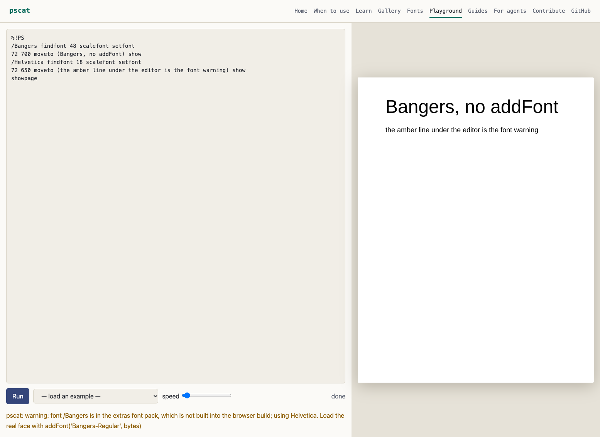

## Playground font warnings and `--fonts` search directories (issues #829, #1113 part 1, 2026-11-12)

**#829.** `site/playground.html` now has the `#warn` element `web/index.html` has and
sets it from `ps.warnings` on every frame, clearing it on each Run, so a stand-in font
(`/Bangers findfont` without `addFont`) shows its note on the page. The colour is a new
`--warn` token in `site/style.css` (amber in the dark theme, a darker amber in the light
one, since the dark theme's amber is unreadable on the cream page). Checked in a real
browser against the built `_site/`: the note appears, and a following clean run clears it.

**#1113 part 1.** `pscat --fonts` now also prints one line per directory font lookup
searches, existing or not, in lookup order: the `fonts/catalog/` overrides, then the
`fonts/packs/` directories:

    # font-search override exists /home/me/.local/share/pscat/fonts/catalog
    # font-search override missing /opt/pscat/fonts/catalog
    # font-search pack-dir missing /home/me/.local/share/pscat/fonts/packs

The path comes last because it can contain spaces. `fontpacks::search_dirs` is built on
`Roots::catalog_dirs_with(&|_| true)` and `Roots::pack_dirs()`; the order and the set of
places are unchanged (pscat-mcp relies on them). The existing `# font-override` and
`# font-pack` lines are untouched (`scripts/font_pack_smoke.sh` and tests grep them).
Decisions: no JSON field (`--fonts` is plain text; `--capabilities` carries a size budget
and is read by pscat-mcp, so it is not grown for this); the cwd's `fonts/catalog` is shown
absolute, which changes only how it prints. In a debug or `ci` build the checkout root
appears twice because the resolver itself lists it twice; that is not changed here.

**Left for after #1078.** Part 2 (an npm README line on fonts) waits for that PR.
